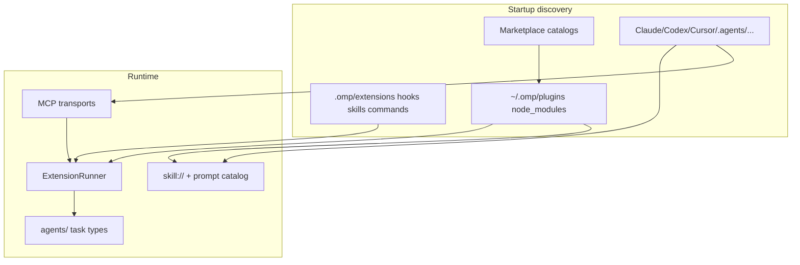

# OMP features, plugins, and community adoption

Research snapshot for [can1357/oh-my-pi](https://github.com/can1357/oh-my-pi) (`omp`), the terminal coding agent distributed at [omp.sh](https://omp.sh). Upstream ships as binary releases (this nix flake pins [v19.0.1](https://github.com/can1357/oh-my-pi/releases/tag/v19.0.1)); the living docs live in the upstream [`docs/`](https://github.com/can1357/oh-my-pi/tree/main/docs) tree and the [README](https://github.com/can1357/oh-my-pi/blob/main/README.md).

## Scope and evidence methodology

**Primary sources used**

| Source class | What was consulted |
| --- | --- |
| Upstream docs | [`docs/*.md`](https://github.com/can1357/oh-my-pi/tree/main/docs) — extensions, marketplace, skills, hooks, MCP, memory, agent hub, context files, LSP, slash commands, etc. |
| Upstream README & packages | [README.md](https://github.com/can1357/oh-my-pi/blob/main/README.md), [CHANGELOG](https://github.com/can1357/oh-my-pi/blob/main/packages/coding-agent/CHANGELOG.md), [release notes](https://github.com/can1357/oh-my-pi/releases), first-party packages under [`packages/`](https://github.com/can1357/oh-my-pi/tree/main/packages) |
| GitHub signals | Issue search (`gh search issues --repo can1357/oh-my-pi`), open/updated issues via GraphQL, [Discussions](https://github.com/can1357/oh-my-pi/discussions) (category samples) |
| Ecosystem artifacts | npm search for `@oh-my-pi` and related packages; GitHub topic/search for adjacent repos |
| This flake | [`pkgs/omp.nix`](../pkgs/omp.nix), [`home/cli/omp.nix`](../home/cli/omp.nix) |

**What this report does *not* claim**

- There is **no public usage telemetry** from omp maintainers. “Frequently used” here means: (a) capabilities heavily documented and marketed as first-party defaults, (b) GitHub issues/PRs/changelog lines showing sustained investment or pain, and (c) third-party repos/packages that explicitly target omp compatibility — with counts taken only from APIs at research time.
- Issue **reaction** metadata was sparse in API responses; **comment volume** and **recurring labels** (e.g. `provider:google-antigravity`, `tool`, `agent`) are used as proxies where noted.

---

## Standout first-party features

Grouped by why practitioners adopt omp beyond a plain chat wrapper. Each row links to owning documentation or release text.

### Editing and code intelligence

| Feature | Entry points / config | Why adopters reach for it | Citation |
| --- | --- | --- | --- |
| **Hashline `edit`** | Tool `edit`; README “§11” | Content-hash anchors reduce failed patches and token waste on weak edit formats | [README §11](https://github.com/can1357/oh-my-pi/blob/main/README.md), [tools reference](https://omp.sh/docs/tools) |
| **`ast_edit` + `ast_grep`** | Tools; `astGrep.enabled` in config | Structural search/replace with preview + accept flow | [README §19](https://github.com/can1357/oh-my-pi/blob/main/README.md), [CHANGELOG](https://github.com/can1357/oh-my-pi/blob/main/packages/coding-agent/CHANGELOG.md) |
| **LSP tool** | Tool `lsp`; `lsp.*` settings; `lsp.diagnosticsOnEdit` | Diagnostics, rename, code actions tied to workspace writes | [README §02](https://github.com/can1357/oh-my-pi/blob/main/README.md), [`docs/lsp-config.md`](https://github.com/can1357/oh-my-pi/blob/main/docs/lsp-config.md) |
| **DAP `debug` tool** | Tool `debug` | lldb/dlv/debugpy-style sessions in the TUI | [README §03](https://github.com/can1357/oh-my-pi/blob/main/README.md) |
| **In-process search/shell** | `grep`, `glob`, `read`, `bash` | No fork/exec dependency on host `rg`/`find`; bash with in-process coreutils | [README §09](https://github.com/can1357/oh-my-pi/blob/main/README.md), [`docs/bash-tool-runtime.md`](https://github.com/can1357/oh-my-pi/blob/main/docs/bash-tool-runtime.md) |
| **Internal URL schemes** | `read`/`grep` on `pr://`, `issue://`, `skill://`, `agent://`, … | One FS-shaped API for GitHub, skills, subagent yields | [README §17](https://github.com/can1357/oh-my-pi/blob/main/README.md) |
| **`github` tool** (optional) | `github.enabled`; tool off unless enabled | GitHub as paths instead of many `gh_*` tools | [README §12](https://github.com/can1357/oh-my-pi/blob/main/README.md) |

### Extensibility primitives

| Primitive | How it loads | Citation |
| --- | --- | --- |
| **TS/JS extensions** | `.omp/extensions`, `~/.omp/agent/extensions`, `omp.extensions` in packages, `--extension` / `-e` | [`docs/extensions.md`](https://github.com/can1357/oh-my-pi/blob/main/docs/extensions.md), [`docs/extension-loading.md`](https://github.com/can1357/oh-my-pi/blob/main/docs/extension-loading.md) |
| **Hooks** | `.omp/hooks/pre|post/`; JS hooks load as extension modules | [`docs/hooks.md`](https://github.com/can1357/oh-my-pi/blob/main/docs/hooks.md) |
| **Custom tools** | Extension `registerTool`, eval `@tool`, settings | [`docs/custom-tools.md`](https://github.com/can1357/oh-my-pi/blob/main/docs/custom-tools.md) |
| **`omp plugin` (npm/git/link)** | `~/.omp/plugins/` tree, `package.json` `omp` / `pi` manifest | [`docs/plugin-manager-installer-plumbing.md`](https://github.com/can1357/oh-my-pi/blob/main/docs/plugin-manager-installer-plumbing.md) |
| **Marketplace** | Claude-compatible catalogs; `/marketplace`, `omp plugin marketplace` | [`docs/marketplace.md`](https://github.com/can1357/oh-my-pi/blob/main/docs/marketplace.md) |
| **Skills** | `skills/<name>/SKILL.md`; `skill://` reads; `/skill:name` | [`docs/skills.md`](https://github.com/can1357/oh-my-pi/blob/main/docs/skills.md) |
| **MCP** | `~/.omp/agent/mcp.json`, project overrides, `mcp.evalNamespaces` | [`docs/mcp-config.md`](https://github.com/can1357/oh-my-pi/blob/main/docs/mcp-config.md) |
| **Cross-harness context import** | Discovery providers for Cursor, Claude, Codex, Copilot, Cline, Windsurf, `.agents/` | [`docs/context-files.md`](https://github.com/can1357/oh-my-pi/blob/main/docs/context-files.md) |

**Pi / Claude compatibility (verified in source docs, not rumor):**

- Extension manifests accept **`package.json.omp`** with fallback **`package.json.pi`** ([plugin manager doc](https://github.com/can1357/oh-my-pi/blob/main/docs/plugin-manager-installer-plumbing.md)).
- Marketplace catalogs support **`.claude-plugin/marketplace.json`** alongside **`.omp-plugin/marketplace.json`** ([marketplace doc](https://github.com/can1357/oh-my-pi/blob/main/docs/marketplace.md)).
- Skill discovery includes **`claude`**, **`claude-plugins`**, **`agent-plugins`**, and legacy **`.pi`** manifest paths in package metadata ([skills doc](https://github.com/can1357/oh-my-pi/blob/main/docs/skills.md), [extension-loading doc](https://github.com/can1357/oh-my-pi/blob/main/docs/extension-loading.md)).

### Multi-agent and execution environments

| Feature | Entry points | Citation |
| --- | --- | --- |
| **`task` subagents** | Tool `task`; `task.*` settings; magic keyword `orchestrate` / `workflowz` | [README §05](https://github.com/can1357/oh-my-pi/blob/main/README.md), [`docs/task-agent-discovery.md`](https://github.com/can1357/oh-my-pi/blob/main/docs/task-agent-discovery.md) |
| **Agent Hub** | `Alt+A`, `/hotkeys` | [`docs/agent-hub.md`](https://github.com/can1357/oh-my-pi/blob/main/docs/agent-hub.md) |
| **Advisor role** | `advisor.enabled`, `modelRoles.advisor` | [README §06](https://github.com/can1357/oh-my-pi/blob/main/README.md), [`docs/advisor-watchdog.md`](https://github.com/can1357/oh-my-pi/blob/main/docs/advisor-watchdog.md) |
| **Persistent `eval` (Python + JS)** | Tool `eval`; tool re-entry bridge | [README §01](https://github.com/can1357/oh-my-pi/blob/main/README.md), [`docs/python-repl.md`](https://github.com/can1357/oh-my-pi/blob/main/docs/python-repl.md) |
| **`browser` + browser relay** | Eval `browser.open`; `omp browser-relay install` | [README §20](https://github.com/can1357/oh-my-pi/blob/main/README.md), [browser-relay README](https://github.com/can1357/oh-my-pi/blob/main/packages/browser-relay/README.md) |
| **`computer` (desktop control)** | Eval `computer.*` helpers | [README §21](https://github.com/can1357/oh-my-pi/blob/main/README.md), [`docs/computer-use.md`](https://github.com/can1357/oh-my-pi/blob/main/docs/computer-use.md) |
| **Collab / join** | `/collab`, `omp join` | [README §07](https://github.com/can1357/oh-my-pi/blob/main/README.md), [`docs/collab.md`](https://github.com/can1357/oh-my-pi/blob/main/docs/collab.md) |
| **Vibe mode** | `/vibe` | [`docs/vibe-mode.md`](https://github.com/can1357/oh-my-pi/blob/main/docs/vibe-mode.md) |

### Context, rules, and memory

| Feature | Entry points | Citation |
| --- | --- | --- |
| **TTSR (stream rules)** | Rule files + regex injection mid-stream | [README §04](https://github.com/can1357/oh-my-pi/blob/main/README.md), [`docs/ttsr-injection-lifecycle.md`](https://github.com/can1357/oh-my-pi/blob/main/docs/ttsr-injection-lifecycle.md) |
| **Sticky `RULES.md` vs `AGENTS.md`** | `.omp/RULES.md`, `.omp/AGENTS.md` | [`docs/context-files.md`](https://github.com/can1357/oh-my-pi/blob/main/docs/context-files.md) |
| **Memory backends** | `memory.backend`: `local`, `hindsight`, `mnemopi`, `sharpshooter` | [`docs/memory.md`](https://github.com/can1357/oh-my-pi/blob/main/docs/memory.md) |
| **Auto-learn** | `learn` tool; `autolearn.enabled`; managed skills | [`docs/skills.md`](https://github.com/can1357/oh-my-pi/blob/main/docs/skills.md) |
| **Compaction / handoff** | `/handoff`, `session.compact` (SDK) | [`docs/compaction.md`](https://github.com/can1357/oh-my-pi/blob/main/docs/compaction.md), [v19.0.0 release notes](https://github.com/can1357/oh-my-pi/releases/tag/v19.0.0) |

### UX, TUI, and workflow

| Feature | Entry points | Citation |
| --- | --- | --- |
| **Model roles & fallbacks** | `modelRoles`, `retry.fallbackChains`, `Ctrl+P`, `/model` | [README “Sixty-plus providers…”](https://github.com/can1357/oh-my-pi/blob/main/README.md), [`docs/models.md`](https://github.com/can1357/oh-my-pi/blob/main/docs/models.md) |
| **Plan mode** | `modelRoles.plan`, `--plan` | [`docs/settings.md`](https://github.com/can1357/oh-my-pi/blob/main/docs/settings.md) |
| **Vim composer** | `tui.vimMode`, related `tui.vim*` settings | [CHANGELOG unreleased Vim entries](https://github.com/can1357/oh-my-pi/blob/main/packages/coding-agent/CHANGELOG.md), issue [#3299](https://github.com/can1357/oh-my-pi/issues/3299) |
| **Magic keywords** | `ultrathink`, `chillax`, `orchestrate`, `workflowz` in user prose | [`docs/magic-keywords.md`](https://github.com/can1357/oh-my-pi/blob/main/docs/magic-keywords.md) |
| **Code review flow** | `/review`, `/annotate` | [README §10](https://github.com/can1357/oh-my-pi/blob/main/README.md), [`docs/slash-command-internals.md`](https://github.com/can1357/oh-my-pi/blob/main/docs/slash-command-internals.md) |
| **Usage stats dashboard** | `omp stats`, `/stats` | [stats package README](https://github.com/can1357/oh-my-pi/blob/main/packages/stats/README.md) |
| **`omp commit`** | CLI `omp commit` | [README §16](https://github.com/can1357/oh-my-pi/blob/main/README.md) |
| **ACP (editor-driven)** | Zed integration; `--mode acp` | [README §14](https://github.com/can1357/oh-my-pi/blob/main/README.md) |

### Built-in repo skills (upstream dogfooding)

The upstream repository ships example skills under [`.omp/skills/`](https://github.com/can1357/oh-my-pi/tree/main/.omp/skills): `semantic-compression`, `system-prompts`, and `tool-prompt-optimization` — indicating how the maintainers expect power users to package prompt/harness tuning as skills.

---

## Plugin, extension, and ecosystem landscape

### How pieces fit together



### Marketplace and Claude plugin catalog

Official documentation positions the **Anthropic Claude marketplace** as the reference install path:

```text
/marketplace add anthropics/claude-plugins-official
/marketplace install wordpress.com@claude-plugins-official
```

([`docs/marketplace.md`](https://github.com/can1357/oh-my-pi/blob/main/docs/marketplace.md))

Installed marketplace plugins land in scope-specific `installed_plugins.json`, symlink into `node_modules`, and expose the same surfaces as npm-installed plugins (skills, hooks, MCP, `omp.extensions` modules). **npm-sourced marketplace entries are explicitly rejected** today (“npm plugin sources are not yet supported” — same doc).

**User-scoped vs project-scoped** installs and shadowing rules are documented in [`docs/marketplace.md`](https://github.com/can1357/oh-my-pi/blob/main/docs/marketplace.md) and [`docs/plugin-manager-installer-plumbing.md`](https://github.com/can1357/oh-my-pi/blob/main/docs/plugin-manager-installer-plumbing.md).

### First-party packages (not all are “plugins”)

| Package | User-facing role | Citation |
| --- | --- | --- |
| `@oh-my-pi/pi-coding-agent` | Main CLI / npm install path | [README install section](https://github.com/can1357/oh-my-pi/blob/main/README.md), [npm](https://www.npmjs.com/package/@oh-my-pi/pi-coding-agent) |
| `browser-relay` | Chrome CDP relay for real tabs | [packages/browser-relay](https://github.com/can1357/oh-my-pi/blob/main/packages/browser-relay/README.md) |
| `stats` | Local usage dashboard (`omp stats`) | [packages/stats](https://github.com/can1357/oh-my-pi/blob/main/packages/stats/README.md) |
| `collab-web` | Browser viewer for collab sessions | [`docs/collab.md`](https://github.com/can1357/oh-my-pi/blob/main/docs/collab.md) |
| `mnemopi` | Mnemopi memory backend | [`docs/mnemosyne-memory-backend.md`](https://github.com/can1357/oh-my-pi/blob/main/docs/mnemosyne-memory-backend.md) |
| `metaharness` | Benchmark harness (edit, terminal-bench, SnapCompact) | [`docs/user-facing-packages.md`](https://github.com/can1357/oh-my-pi/blob/main/docs/user-facing-packages.md) |
| `@oh-my-pi/omptype` | Published schema library for extensions | [omptype README](https://github.com/can1357/oh-my-pi/tree/main/packages/omptype) |

Most `@oh-my-pi/pi-natives-*` npm packages are **platform binary shards** for the agent, not end-user feature plugins ([npm search snapshot](https://www.npmjs.com/search?q=%40oh-my-pi)).

### Third-party packages and repos (observed, with stars as weak popularity signal)

| Artifact | Description | Stars / npm | Compatibility claim (from their README/npm) |
| --- | --- | --- | --- |
| [am-will/gooey-pi](https://github.com/am-will/gooey-pi) | Desktop workbench for Pi / OMP / Prime Agent | ~984 stars (GitHub API, 2026-11-24) | Names OMP explicitly |
| [AVIDS2/memorix](https://github.com/AVIDS2/memorix) | Cross-agent memory via MCP | ~946 stars | Lists “Oh-my-Pi” among supported agents |
| [the-snowpear/omp-studio](https://github.com/the-snowpear/omp-studio) | Multi-window OMP workbench | ~234 stars | oh-my-pi desktop GUI |
| [pulseaiclub/phi](https://github.com/pulseaiclub/phi) | Fast coding agent / MCP / subagents | ~1013 stars | Pi/OMP-adjacent harness |
| [gim47656-ship-it/CUELO](https://github.com/gim47656-ship-it/CUELO) | Workspace harness for omp | npm [`cuelo`](https://www.npmjs.com/package/cuelo) | Keywords include `oh-my-pi`, `omp` |
| [bopstack/pi-codegraph](https://github.com/bopstack/pi-codegraph) | CodeGraph extension | npm [`@bopstack/pi-codegraph`](https://www.npmjs.com/package/@bopstack/pi-codegraph) | “Pi and Oh My Pi” |
| [Signet-AI/signetai](https://github.com/Signet-AI/signetai) | Lifecycle connector | npm [`@signetai/connector-oh-my-pi`](https://www.npmjs.com/package/@signetai/connector-oh-my-pi) | Dedicated omp connector package |
| [@subshell-ai/plugin-oh-my-pi](https://www.npmjs.com/package/@subshell-ai/plugin-oh-my-pi) | Subshell harness plugin | npm | “Oh My Pi harness plugin” |

**Community “show and tell” (Discussions):** examples include [OMP Studio](https://github.com/can1357/oh-my-pi/discussions/19811) and [visual-omp](https://github.com/can1357/oh-my-pi/discussions/20434) — third-party UIs wrapping the same agent.

### MCP as an established external integration path

Because omp natively loads `mcp.json` and re-exposes servers as tools (and optionally `mcp.evalNamespaces` / `xd://` in eval — [v19.0.0 release](https://github.com/can1357/oh-my-pi/releases/tag/v19.0.0)), **MCP** is an established integration path (for example Context7, NixOS, Atlassian, and custom stdio/http servers, as in this flake’s [`home/cli/omp.nix`](../home/cli/omp.nix)). Feature requests around MCP session toggles, OAuth, and Skills extension appear in upstream issues (e.g. [#19708](https://github.com/can1357/oh-my-pi/issues/19708), [#13702](https://github.com/can1357/oh-my-pi/issues/13702)).

---

## What users talk about and request most

Derived from GitHub issue search and labels (not weighted by anonymous usage).

### Provider routing, quotas, and auth

The **highest-comment threads** cluster around **Google Antigravity** false `429 RESOURCE_EXHAUSTED` / quota handling ([#11689](https://github.com/can1357/oh-my-pi/issues/11689), [#12655](https://github.com/can1357/oh-my-pi/issues/12655), [#11699](https://github.com/can1357/oh-my-pi/issues/11699)). Related: Antigravity CLI usage metering ([#19397](https://github.com/can1357/oh-my-pi/issues/19397), [#20435](https://github.com/can1357/oh-my-pi/issues/20435)).

**OpenAI Codex** websocket / native-turn errors ([#14158](https://github.com/can1357/oh-my-pi/issues/14158)) and **credential failover** ([#17637](https://github.com/can1357/oh-my-pi/issues/17637)) are recurring.

**Enhancement pressure:** more providers (e.g. [#1666 Command Code](https://github.com/can1357/oh-my-pi/issues/1666)), per-model compaction ([#6835](https://github.com/can1357/oh-my-pi/issues/6835)), smaller system prompts for local models ([#1734](https://github.com/can1357/oh-my-pi/issues/1734)).

*Interpretation:* A large slice of active users optimizes **modelRoles + fallbackChains + OAuth coding plans** — matching README emphasis on 60+ providers ([README](https://github.com/can1357/oh-my-pi/blob/main/README.md)).

### Tools, editing, and agent loop reliability

- **Edit tool compatibility** with specific models (DeepSeek, MiMo) ([#9717](https://github.com/can1357/oh-my-pi/issues/9717), [#3772](https://github.com/can1357/oh-my-pi/issues/3772)).
- **Compaction** failures / context pressure ([#9235](https://github.com/can1357/oh-my-pi/issues/9235), provider-specific compaction bugs e.g. [#5184 Copilot](https://github.com/can1357/oh-my-pi/issues/5184)).
- **Heavy subagent / memory** incidents on Linux ([#19040](https://github.com/can1357/oh-my-pi/issues/19040), [#16067](https://github.com/can1357/oh-my-pi/issues/16067)).

### TUI, tmux, and Vim editing

Long-running requests for **Vim-style composer** ([#3299](https://github.com/can1357/oh-my-pi/issues/3299)) shipped substantial work in recent CHANGELOG entries ([CHANGELOG Vim section](https://github.com/can1357/oh-my-pi/blob/main/packages/coding-agent/CHANGELOG.md)). Follow-ons: word motions ([#12812](https://github.com/can1357/oh-my-pi/issues/12812)), cursor shape ([#11655](https://github.com/can1357/oh-my-pi/issues/11655)).

TUI regressions (streaming pins, ask-tool layout) stay open ([#9780](https://github.com/can1357/oh-my-pi/issues/9780), [#12398](https://github.com/can1357/oh-my-pi/issues/12398)).

### Plugins, marketplace, and skills

- Marketplace **dependency install parity with Claude Code** ([#18694](https://github.com/can1357/oh-my-pi/issues/18694)).
- **Upgrade/reconnect** behavior for marketplace + MCP ([#20441](https://github.com/can1357/oh-my-pi/issues/20441), [#16981](https://github.com/can1357/oh-my-pi/issues/16981)).
- **npm plugin upgrade** gaps ([#13861](https://github.com/can1357/oh-my-pi/issues/13861)).
- **MCP Skills extension** support ([#13702](https://github.com/can1357/oh-my-pi/issues/13702)).
- **Auto-skill learning** proposals ([#2189](https://github.com/can1357/oh-my-pi/issues/2189)).

### Recent upstream investment areas (changelog / releases)

v19.x highlights from [v19.0.0 release](https://github.com/can1357/oh-my-pi/releases/tag/v19.0.0) and [CHANGELOG](https://github.com/can1357/oh-my-pi/blob/main/packages/coding-agent/CHANGELOG.md):

- Shared **daemon** + **Tern** live cards for subagents/background jobs.
- **MCP eval namespaces**, built-in MCP transforms, stricter stdio handshake fixes ([#20292](https://github.com/can1357/oh-my-pi/issues/20292)).
- **Browser/relay** and **hashline/ast** hardening.
- **Extension UI migration** away from direct `pi-tui` package imports (`@oh-my-pi/pi-tui`, `@mariozechner/pi-tui`, `@earendil-works/pi-tui`) to host-provided `ui` + JSX nodes or `{ render(width): string[] }` objects (breaking for extension authors).

---

## Quick comparison: this flake’s `omp` setup

| Area | This workstation (`home/cli/omp.nix`) | Notable upstream capability left unused or default-off here |
| --- | --- | --- |
| **Version** | Binary [v19.0.1](https://github.com/can1357/oh-my-pi/releases/tag/v19.0.1) via [`pkgs/omp.nix`](../pkgs/omp.nix) | Upstream latest on npm/GitHub was **v19.1.1** at research time |
| **Model roles** | Rich `modelRoles` (Gemini, GPT, Cursor Composer, web search roles) + `retry.fallbackChains` | Many OAuth providers available via `/login` but not pre-wired here ([`docs/providers.md`](https://github.com/can1357/oh-my-pi/blob/main/docs/providers.md)) |
| **Advisor** | `advisor.enabled: true` | Matches high-value README feature ([README §06](https://github.com/can1357/oh-my-pi/blob/main/README.md)) |
| **Subagents / task** | `task.perCallModel: on`, `task.agentModelOverrides`, `display.subagentLivePreview: true` | Agent Hub (`Alt+A`) always available; worktree-isolated tasks optional upstream |
| **Editing intelligence** | `astGrep.enabled`, `lsp.diagnosticsOnEdit`, `bashInterceptor`, `bash.gitGuard` | `debug` (DAP), `security_scan`, `generate_image`, `tts` still setting-gated off by default globally ([README tools section](https://github.com/can1357/oh-my-pi/blob/main/README.md)) |
| **GitHub tool** | `github.enabled: true` | — |
| **Skills** | Custom dirs: `~/.agents/skills/pocock`, pstack paths | No marketplace plugins configured in nix; Claude marketplace not pre-added |
| **MCP** | `nixos` (stdio), `context7` (http), optional `atlassian` | Other community MCPs left to user `mcp.json` |
| **Memory** | Not set in managed `desiredConfig` (defaults to **off** per [`docs/memory.md`](https://github.com/can1357/oh-my-pi/blob/main/docs/memory.md)) | `memory.backend: local` / Mnemopi / Hindsight / `learn` pipelines available |
| **TUI** | `tui.vimMode: true`, Gruvbox custom themes when `appearance.isGruvbox` | `omp stats` dashboard not invoked from nix |
| **Context** | Managed `AGENTS.md` / `RULES.md` under `~/.omp/agent/` | Project `.omp/AGENTS.md` per-repo still user responsibility ([`docs/context-files.md`](https://github.com/can1357/oh-my-pi/blob/main/docs/context-files.md)) |
| **Browser relay** | Not configured in nix | `omp browser-relay install` + `browser.relay` for logged-in Chrome ([browser-relay README](https://github.com/can1357/oh-my-pi/blob/main/packages/browser-relay/README.md)) |

---

## Practical takeaways for omp users

1. **Default power path** — Stay on first-party tools (`read`, `edit`, `ast_edit`, `grep`, `lsp`, `task`, `eval`, optional `github`/`browser`) before adding extensions; the README’s benchmark narrative is tied to this stack ([README](https://github.com/can1357/oh-my-pi/blob/main/README.md), [harness blog post](https://blog.can.ac/2026/02/12/the-harness-problem/)).

2. **Extensibility ladder** — (a) drop skills in `.omp/skills` or `.agents/skills`, (b) add MCP servers, (c) `omp plugin install` npm/git packages with `omp`/`pi` manifests, (d) install Claude marketplace plugins, (e) author TS extensions in `.omp/extensions` ([skills](https://github.com/can1357/oh-my-pi/blob/main/docs/skills.md), [marketplace](https://github.com/can1357/oh-my-pi/blob/main/docs/marketplace.md), [extensions](https://github.com/can1357/oh-my-pi/blob/main/docs/extensions.md)).

3. **Multi-agent workflows** — `task` + Agent Hub + advisor role is the maintained “fan-out + oversight” pattern; third-party GUIs (gooey-pi, omp-studio) wrap the same runtime rather than replacing it.

4. **Operational pain mirrors GitHub** — Plan for provider quota debugging, compaction tuning, and MCP lifecycle (`/reload-plugins`, session restarts after marketplace changes per [marketplace doc](https://github.com/can1357/oh-my-pi/blob/main/docs/marketplace.md)).

---

## Gaps and limitations of this research

- GitHub **issue reaction counts** were not reliably available via the CLI queries used; ranking uses comments, labels, and search sort where possible.
- **Download counts** for marketplace plugins and private npm plugins were not queried; only package existence/metadata was verified on npm.
- **Discord** ([linked from README](https://github.com/can1357/oh-my-pi/blob/main/README.md)) may hold informal adoption signals but was out of scope (not a durable primary API).
- Upstream moves quickly — extension authors face a breaking **extension UI migration** off direct `pi-tui` package imports onto JSX nodes / host-provided `ui` per the current CHANGELOG breaking section ([CHANGELOG](https://github.com/can1357/oh-my-pi/blob/main/packages/coding-agent/CHANGELOG.md)).